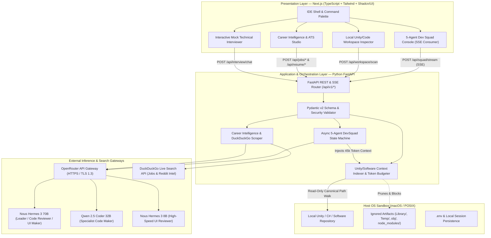
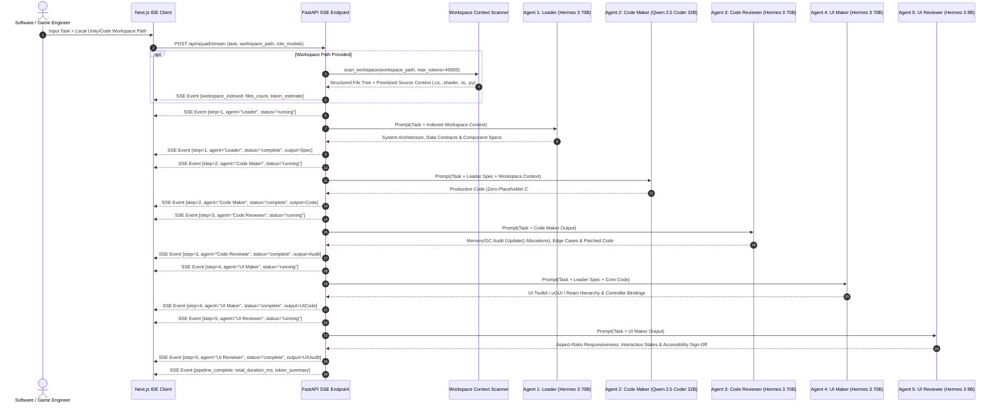
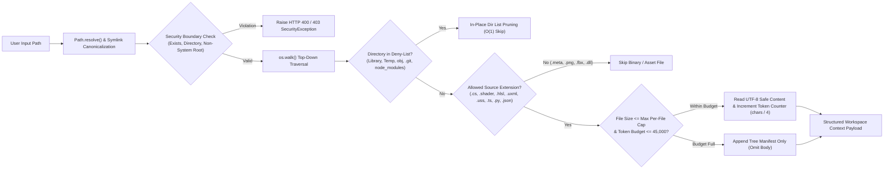
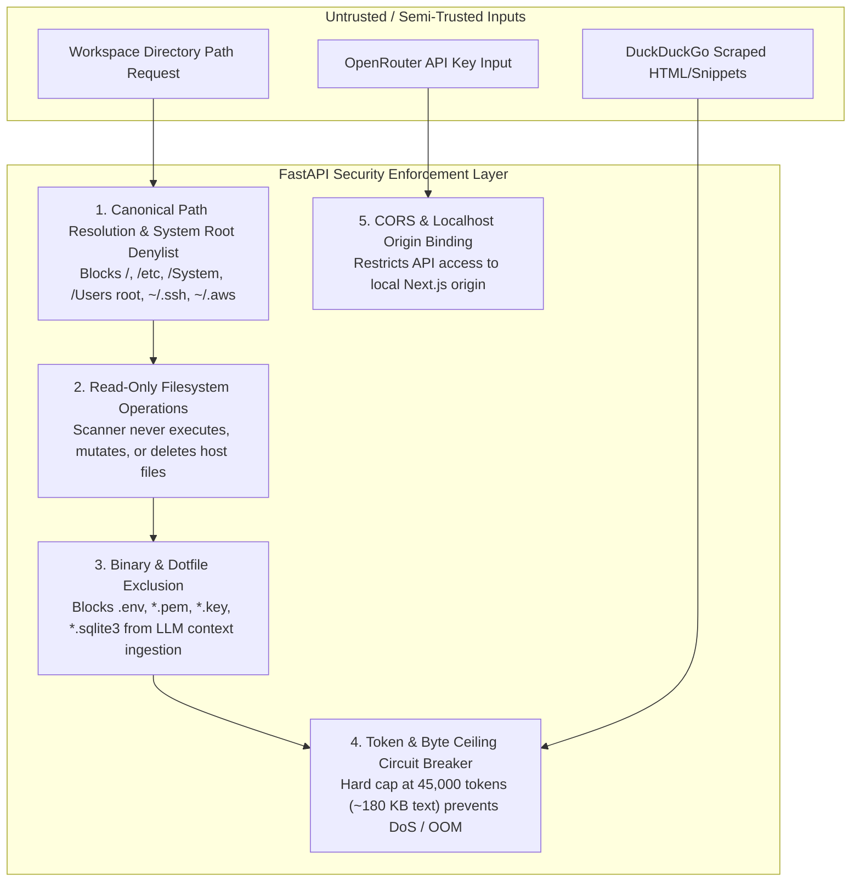

# Hermes Studio v2 — System Architecture & Engineering Specification

> **Document Status:** Accepted (v2.0 Production Specification)  
> **Principal Domain:** Local-First AI Engineering Workbench, Autonomous 5-Agent Software/Game Development Pipeline & Career Intelligence Engine  
> **Stack:** Next.js 15+ (App Router, TypeScript, Tailwind CSS, Shadcn/UI) · Python 3.11+ FastAPI (Async SSE, Pydantic v2) · OpenRouter Multi-Model Routing (`Hermes 3 70B`, `Qwen 2.5 Coder 32B`, `Hermes 3 8B`)

---

## 1. Executive Summary & Design Philosophy

**Hermes Studio v2** is a local-first, Claude-Code-grade AI IDE and autonomous multi-agent engineering suite purpose-built for **Unity C# Game Engineering**, **Full-Stack Software Development**, and **Technical Career Intelligence**.

Originally prototyped as a monolithic synchronous Streamlit script (`/legacy-streamlit`), v2 re-architects the system into a decoupled **Reactive Frontend + Asynchronous FastAPI Micro-Kernel** capable of:
1. **Real-Time Server-Sent Events (SSE) Telemetry:** Streaming multi-stage agent reasoning, code generation, and review passes with zero UI thread blocking and sub-millisecond state transitions.
2. **Local Unity & Software Workspace Indexing:** Mounting local macOS/POSIX project directories directly into the agent pipeline while pruning multi-gigabyte engine artifacts (`Library/`, `Temp/`, `obj/`, `.git/`) and enforcing a deterministic **45,000-token context budget**.
3. **Heterogeneous Multi-Agent Model Routing:** Matching cognitive complexity to model capability across `Nous Hermes 3 70B`, `Qwen 2.5 Coder 32B`, and `Nous Hermes 3 8B`, reducing monthly inference expenditure by **80–85%** (~$3.50/month for 150 full 5-agent pipelines) compared to flat-rate frontier subscriptions.

---

## 2. High-Level System Architecture

The system is partitioned into four strict architectural boundaries: the **Presentation Layer (Next.js App Router)**, the **Application Gateway & Orchestration Layer (FastAPI)**, the **Local Filesystem Sandbox (Workspace Scanner)**, and **External Inference & Search Providers (OpenRouter + DuckDuckGo)**.



---

## 3. Core Subsystem Specifications

### 3.1. Presentation Layer (`/frontend`)
- **Framework:** Next.js (App Router) with strict TypeScript (`strict: true`).
- **Styling & Design System:** Dark-mode native engineering workbench built with Tailwind CSS and Shadcn/UI primitives (`zinc-950` surface hierarchy, `indigo-500` active agent indicators, `emerald-500` pass badges, `amber-500` token budget warnings).
- **Streaming State Management:** Custom `fetch` + `ReadableStream` SSE parser decoding chunked `data: {...}\n\n` events into an immutable per-agent execution timeline without blocking React rendering or losing scroll lock.
- **Zero-Trust Secret Handling:** OpenRouter API keys can be configured server-side via root `.env` or passed transiently over localhost headers without persisting plaintext secrets in third-party telemetry.

### 3.2. Orchestration & API Layer (`/backend`)
- **Framework:** Python FastAPI running on Uvicorn with asynchronous request handlers and generator-backed `StreamingResponse` endpoints.
- **Contract-First Typing:** Every request payload and SSE event frame is strictly validated via Pydantic v2 models before execution.
- **Fault Isolation:** Upstream OpenRouter rate limits, network timeouts, or DuckDuckGo scraping anomalies are caught at the service boundary and emitted as structured error frames rather than crashing the Uvicorn worker process.

---

## 4. Multi-Agent Dev Squad Pipeline (Sequence & State Flow)

The flagship **5-Agent Dev Squad** decomposes complex engineering tasks into five specialized, sequential cognitive stages. Unlike single-shot LLM prompts that suffer from instruction dilution when asked to simultaneously architect, code, optimize memory, and design UI, Hermes Studio v2 isolates each concern into a dedicated system persona and specialized model weight class.



### Agent Responsibilities & Verification Criteria
| Step | Agent Persona | Default Model | Primary Engineering Focus | Domain Verification Targets |
| :--- | :--- | :--- | :--- | :--- |
| **1** | **Leader (Architect)** | `Hermes 3 70B` | System decomposition, data flow, interface contracts | ScriptableObject schemas, decoupled event buses, SOLID boundaries |
| **2** | **Code Maker** | `Qwen 2.5 Coder 32B` | High-density syntax synthesis, complete implementation | Complete namespaces, strict typing, zero `// TODO` placeholders |
| **3** | **Code Reviewer** | `Hermes 3 70B` | Performance profiling, static logic analysis, bug patching | Zero heap allocations in Unity `Update()`/`FixedUpdate()`, null safety, race conditions |
| **4** | **UI Maker** | `Hermes 3 70B` | View hierarchy, reactive state binding, controller logic | Unity UI Toolkit (`.uxml`/`.uss`), uGUI Canvas scaling, or React/Tailwind components |
| **5** | **UI Reviewer** | `Hermes 3 8B` | Ergonomics, visual hierarchy, interaction state completeness | 16:9 / 21:9 / Ultrawide anchor behavior, hover/disabled/focus states |

---

## 5. Local Unity & Software Workspace Context Indexing

A core innovation in Hermes Studio v2 (detailed in [ADR-002](./adr/002-local-unity-workspace-scanner-and-token-budgeting.md)) is the **Deterministic Workspace Context Scanner**. Game engines like Unity generate tens of thousands of cache, metadata, and binary files (`Library/`, `Temp/`, `Logs/`) that will immediately exhaust an LLM's context window and bankrupt token budgets if naively ingested.



---

## 6. Security Boundaries & Threat Model

Because Hermes Studio v2 runs locally with access to the host filesystem and external LLM APIs, strict defense-in-depth controls are enforced at the FastAPI boundary:



1. **Path Traversal & Sensitive Directory Prevention:** All workspace paths undergo `Path(raw_path).expanduser().resolve()`. Traversal attempts (`../../etc/passwd`) or attempts to index sensitive system/credential directories (`/etc`, `/var`, `/System`, `~/.ssh`, `~/.aws`, `~/.gnupg`) are deterministically rejected with HTTP `403 Forbidden`.
2. **Secret Exfiltration Prevention:** Even within a valid project workspace, secret files (`.env`, `.env.*`, `*.pem`, `*.key`, `credentials.json`) and Unity `.meta` GUID noise are strictly excluded from the context payload before any prompt leaves the machine to OpenRouter.
3. **Read-Only Invariant:** The workspace scanner operates exclusively with read-only file descriptors (`open(..., mode="r", encoding="utf-8", errors="replace")`) and never invokes shell sub-processes (`subprocess.Popen(..., shell=True)` is forbidden).

---

## 7. Repository Directory Structure

```text
hermes-agent-suite/
├── backend/                  # FastAPI Async Backend, Workspace Scanner & SSE Orchestrator
├── frontend/                 # Next.js 15+ (App Router), TypeScript, Tailwind & Shadcn/UI IDE
├── docs/                     # Architectural Specifications & Engineering Decision Records
│   ├── ARCHITECTURE.md       # System Architecture & Threat Model (this document)
│   └── adr/                  # Architecture Decision Records (ADRs)
│       ├── 001-nextjs-fastapi-decoupled-architecture.md
│       ├── 002-local-unity-workspace-scanner-and-token-budgeting.md
│       └── 003-hybrid-openrouter-multi-agent-orchestration.md
├── legacy-streamlit/         # Archived v1 Monolithic Streamlit Prototype & CLI
│   ├── agents/               # v1 Synchronous DevSquad & JobAssistant
│   ├── app.py                # v1 Streamlit Dashboard
│   ├── cli.py                # v1 Terminal Runner
│   └── config.py             # v1 Model Role Mappings
├── .env.example              # Environment variable template
├── .gitignore                # Git tracking exclusions
├── master_resume_example.md  # Sample engineering profile for ATS Resume Tailor testing
└── README.md                 # Project overview, benchmarks & quickstart guide
```

---

## 8. Architecture Decision Records (ADR Index)

- **[ADR-001: Migration from Monolithic Streamlit to Decoupled Next.js + FastAPI Architecture](./adr/001-nextjs-fastapi-decoupled-architecture.md)**
- **[ADR-002: Local Unity Workspace Scanner, Directory Pruning, and 45k Token Budgeting](./adr/002-local-unity-workspace-scanner-and-token-budgeting.md)**
- **[ADR-003: Cost-Optimized Hybrid Multi-Agent Orchestration via OpenRouter](./adr/003-hybrid-openrouter-multi-agent-orchestration.md)**
