# Hermes Studio v2 — Agile Engineering Kanban Board & Sprint Tracker

> **Project:** Hermes Studio v2 (Full-Stack Autonomous Multi-Agent IDE & Career Intelligence Suite)  
> **Methodology:** Trunk-Based Agile Scrum with Peer Architectural Review & Contract-First API Design  
> **Current Release:** `v2.0.0` (All Sprints Completed & Verified)  
> **Related Docs:** [System Architecture (`ARCHITECTURE.md`)](./ARCHITECTURE.md) | [ADRs (`docs/adr/`)](./adr/) | [Code Review Log (`CODE_REVIEW_LOG.md`)](./CODE_REVIEW_LOG.md)

---

## Executive Sprint Summary & Velocity Metrics

| Sprint | Focus Area | Tickets Completed | Story Points | Primary Engineering Deliverables | Status |
| :--- | :--- | :---: | :---: | :--- | :---: |
| **Sprint 1** | **Architecture, Threat Model & ADRs** | 4 / 4 | 21 pts | `docs/ARCHITECTURE.md`, `ADR-001`, `ADR-002`, `ADR-003`, Legacy Archival | **DONE** |
| **Sprint 2** | **FastAPI Core, SQLite & Workspace Engine** | 6 / 6 | 34 pts | `backend/main.py`, SQLite WAL Engine, Unity/C# Scanner (45k Token Cap), 6 Agent Workflows | **DONE** |
| **Sprint 3** | **Claude-Grade Next.js 16 Dark IDE UI/UX** | 6 / 6 | 34 pts | `frontend/` App Router, `AgentStepsAccordion`, `MarkdownRenderer`, Workspace & Telemetry Modals | **DONE** |
| **Sprint 4** | **Peer Review, QA, DevOps & Telemetry** | 5 / 5 | 21 pts | Cross-Stack Contract Verification, `CODE_REVIEW_LOG.md`, `start-studio.sh`, Portfolio `README.md` | **DONE** |
| **Total** | **Full-Stack Production Delivery** | **21 / 21** | **110 pts** | **Zero-Lockout Local AI Engineering Workbench (~$3.50/mo via OpenRouter)** | **SHIPPED** |

---

## Multi-Sprint Delivery Roadmap

```mermaid
flowchart LR
    subgraph S1["Sprint 1: Architecture & ADRs"]
        ARCH01["ARCH-01: System Architecture & Threat Model"]
        ARCH02["ARCH-02: ADR-001 Next.js + FastAPI Decoupling"]
        ARCH03["ARCH-03: ADR-002 Unity Workspace Token Budgeting"]
        ARCH04["ARCH-04: ADR-003 Hybrid OpenRouter Orchestration"]
    end

    subgraph S2["Sprint 2: FastAPI Core & Workspace Engine"]
        API01["API-01: FastAPI Core & Pydantic v2 Contracts"]
        DB01["DB-01: SQLite Session & Telemetry Persistence"]
        WS01["WS-01: Local Unity/C# Workspace Scanner (45k Cap)"]
        ORCH01["ORCH-01: OpenRouter Client & Cost Telemetry"]
        ORCH02["ORCH-02: 5-Agent Dev Squad Pipeline"]
        ORCH03["ORCH-03: Career Hunter, ATS & Video Workflows"]
    end

    subgraph S3["Sprint 3: Claude-Grade Next.js UI/UX"]
        UI01["UI-01: Next.js App Router & Strict TypeScript Client"]
        UI02["UI-02: IDE Shell, Sidebar & TopBar Mode Switcher"]
        UI03["UI-03: AgentStepsAccordion Live Reasoning View"]
        UI04["UI-04: Pro Code Block & Markdown Renderer"]
        UI05["UI-05: Local Workspace Drawer & Token Budget Gauge"]
        UI06["UI-06: Telemetry, Cost Breakdown & API Key Modal"]
    end

    subgraph S4["Sprint 4: Peer Review, QA & DevOps"]
        QA01["QA-01: Cross-Stack API & Schema Contract Audit"]
        QA02["QA-02: Security & Path Traversal Verification"]
        OPS01["OPS-01: 1-Command macOS Studio Launcher (start-studio.sh)"]
        DOC01["DOC-01: Recruiter Portfolio README & Kanban Documentation"]
    end

    S1 --> S2 --> S3 --> S4
```

---

## Sprint 1: Architecture, Threat Modeling & ADRs

**Sprint Goal:** Establish strict architectural boundaries before writing application code, archive the monolithic v1 Streamlit prototype into `/legacy-streamlit`, and author formal Architecture Decision Records (ADRs) justifying stack, security, and token-economics choices.

| Ticket ID | Title & Scope | Assigned Subagent | Priority | Status | Review Status | Engineering Notes & Verification |
| :--- | :--- | :--- | :---: | :---: | :---: | :--- |
| **`ARCH-01`** | **System Architecture & Threat Model Specification** | Principal Software Architect | `P0 - Critical` | Done | Approved | Authored [`docs/ARCHITECTURE.md`](./ARCHITECTURE.md) with 4 Mermaid diagrams covering C4 container topology, 5-agent sequence flow, scanner decision tree, and local filesystem threat boundaries. |
| **`ARCH-02`** | **ADR-001: Decoupled Next.js + FastAPI Architecture** | Principal Software Architect | `P0 - Critical` | Done | Approved | Documented in [`docs/adr/001-nextjs-fastapi-decoupled-architecture.md`](./adr/001-nextjs-fastapi-decoupled-architecture.md). Eliminated Streamlit full-script reruns in favor of React state + async FastAPI REST/streaming endpoints. |
| **`ARCH-03`** | **ADR-002: Local Unity Workspace Scanner & 45k Token Cap** | Principal Software Architect | `P0 - Critical` | Done | Approved | Documented in [`docs/adr/002-local-unity-workspace-scanner-and-token-budgeting.md`](./adr/002-local-unity-workspace-scanner-and-token-budgeting.md). Enforces `O(1)` subtree pruning on `Library/`, `Temp/`, `obj/`, `.git/` and blocks `.meta` GUID noise. |
| **`ARCH-04`** | **ADR-003: Hybrid OpenRouter Multi-Agent Model Routing** | Principal Software Architect | `P1 - High` | Done | Approved | Documented in [`docs/adr/003-hybrid-openrouter-multi-agent-orchestration.md`](./adr/003-hybrid-openrouter-multi-agent-orchestration.md). Pairs `Hermes 3 70B` (Architecture/Review) with `Qwen 2.5 Coder 32B` (Code Gen) and `Hermes 3 8B` (Fast UX Audit) at ~$0.024/run. |

---

## Sprint 2: FastAPI Core, SQLite Persistence & Workspace Engine

**Sprint Goal:** Build a rock-solid, strictly typed Python FastAPI backend (`/backend`) featuring persistent SQLite session/telemetry storage, a sandboxed local Unity/C#/Software workspace scanner, and 6 specialized multi-agent workflows powered by OpenRouter.

| Ticket ID | Title & Scope | Assigned Subagent | Priority | Status | Review Status | Engineering Notes & Verification |
| :--- | :--- | :--- | :---: | :---: | :---: | :--- |
| **`API-01`** | **FastAPI Application Kernel & Pydantic v2 Schemas** | Staff Backend Engineer | `P0 - Critical` | Done | Approved | Implemented [`backend/main.py`](../backend/main.py), [`backend/config.py`](../backend/config.py), and [`backend/models/schemas.py`](../backend/models/schemas.py). Configured CORS for `localhost:3000` and lifespan database initialization. |
| **`DB-01`** | **SQLite Session, Message & Telemetry Engine** | Staff Backend Engineer | `P0 - Critical` | Done | Approved | Implemented [`backend/database.py`](../backend/database.py) with WAL-mode concurrency, JSON-serialized `agent_steps`, automatic welcome session seeding, and historical token/cost aggregation queries. |
| **`WS-01`** | **Local Unity/C# Workspace Scanner & Security Sandbox** | Staff Backend Engineer | `P0 - Critical` | Done | Approved | Built [`backend/services/workspace_scanner.py`](../backend/services/workspace_scanner.py) and [`backend/routers/workspace.py`](../backend/routers/workspace.py). Enforces canonical path validation, system directory denylists (`/etc`, `/System`, `~/.ssh`), Unity ProjectVersion detection, and a 45,000-token context budget. |
| **`ORCH-01`** | **OpenRouter Client & Exact Token Cost Calculator** | Staff Backend Engineer | `P0 - Critical` | Done | Approved | Built [`backend/services/openrouter_client.py`](../backend/services/openrouter_client.py). Captures prompt/completion token usage, calculates exact USD micro-costs per model tier, and logs latency (`duration_ms`) into SQLite telemetry. |
| **`ORCH-02`** | **5-Agent Autonomous Dev Squad Workflow** | Staff Backend Engineer | `P0 - Critical` | Done | Approved | Built [`backend/services/workflows/dev_squad.py`](../backend/services/workflows/dev_squad.py). Orchestrates Leader (`Hermes 70B`) -> Code Maker (`Qwen 2.5 Coder 32B`) -> Code Reviewer (`Hermes 70B`) -> UI Maker (`Hermes 70B`) -> UI Reviewer (`Hermes 8B`) with optional workspace context injection. |
| **`ORCH-03`** | **Career Intelligence, ATS Resume & Video Script Workflows** | Staff Backend Engineer | `P1 - High` | Done | Approved | Built [`backend/services/workflows/career_hunter.py`](../backend/services/workflows/career_hunter.py) (DuckDuckGo live job search, Reddit interview mining, ATS Resume Tailor, Mock Interview Coach) and [`backend/services/workflows/content_video.py`](../backend/services/workflows/content_video.py) (YouTube/TikTok Video Script Studio). |

---

## Sprint 3: Claude-Grade Next.js 16 Dark IDE UI/UX

**Sprint Goal:** Construct a sleek, responsive, dark-mode AI engineering command center (`/frontend`) inspired by Claude Desktop, Cursor, and Linear using Next.js App Router, TypeScript, Tailwind CSS, and Lucide iconography.

| Ticket ID | Title & Scope | Assigned Subagent | Priority | Status | Review Status | Engineering Notes & Verification |
| :--- | :--- | :--- | :---: | :---: | :---: | :--- |
| **`UI-01`** | **Next.js App Router, TypeScript Contracts & API Client** | Senior Frontend Engineer | `P0 - Critical` | Done | Approved | Created [`frontend/src/lib/types.ts`](../frontend/src/lib/types.ts), [`frontend/src/lib/constants.ts`](../frontend/src/lib/constants.ts), and [`frontend/src/lib/api.ts`](../frontend/src/lib/api.ts) with 1:1 parity against FastAPI Pydantic models. |
| **`UI-02`** | **IDE Shell, Collapsible Session Sidebar & TopBar** | Senior Frontend Engineer | `P0 - Critical` | Done | Approved | Built [`frontend/src/app/page.tsx`](../frontend/src/app/page.tsx), [`frontend/src/components/Sidebar.tsx`](../frontend/src/components/Sidebar.tsx), and [`frontend/src/components/TopBar.tsx`](../frontend/src/components/TopBar.tsx) with 6 workflow modes, model selector, workspace badge, and live spend indicator. |
| **`UI-03`** | **Collapsible 5-Agent Reasoning Accordion** | Senior Frontend Engineer | `P0 - Critical` | Done | Approved | Built [`frontend/src/components/AgentStepsAccordion.tsx`](../frontend/src/components/AgentStepsAccordion.tsx). Displays per-agent persona badges, model IDs, execution latency (`ms`), token counts, and expandable Markdown outputs for each stage of the pipeline. |
| **`UI-04`** | **Syntax-Highlighted Code & GFM Markdown Renderer** | Senior Frontend Engineer | `P1 - High` | Done | Approved | Built [`frontend/src/components/MarkdownRenderer.tsx`](../frontend/src/components/MarkdownRenderer.tsx) with language header bars, 1-click clipboard copy, line-wrapping support, and clean table/list typography. |
| **`UI-05`** | **Local Unity/Code Workspace Inspector Modal** | Senior Frontend Engineer | `P1 - High` | Done | Approved | Built [`frontend/src/components/WorkspaceModal.tsx`](../frontend/src/components/WorkspaceModal.tsx) and [`frontend/src/components/BottomComposer.tsx`](../frontend/src/components/BottomComposer.tsx). Visualizes scanned project type (Unity vs. General), file tree, extension breakdown, and 45k token budget utilization bar. |
| **`UI-06`** | **Cost Telemetry Dashboard & Runtime API Key Modal** | Senior Frontend Engineer | `P1 - High` | Done | Approved | Built [`frontend/src/components/SettingsTelemetryModal.tsx`](../frontend/src/components/SettingsTelemetryModal.tsx). Compares actual OpenRouter spend against $20/mo subscriptions, breaks down cost by model, and supports hot-swapping the OpenRouter API key. |

---

## Sprint 4: Peer Review, QA, DevOps & Portfolio Polish

**Sprint Goal:** Perform end-to-end contract verification between Next.js and FastAPI, audit security boundaries, provide a 1-command macOS startup script (`./start-studio.sh`), and package the repository with recruiter-ready engineering documentation.

| Ticket ID | Title & Scope | Assigned Subagent | Priority | Status | Review Status | Engineering Notes & Verification |
| :--- | :--- | :--- | :---: | :---: | :---: | :--- |
| **`QA-01`** | **Cross-Stack API & TypeScript Schema Verification** | Principal Architect & QA Lead | `P0 - Critical` | Done | Approved | Verified all REST routes (`/api/health`, `/api/sessions`, `/api/chat`, `/api/workspace/scan`, `/api/telemetry`) and documented findings in [`docs/CODE_REVIEW_LOG.md`](./CODE_REVIEW_LOG.md). |
| **`QA-02`** | **Workspace Security & Path Traversal Audit** | QA & Security Specialist | `P0 - Critical` | Done | Approved | Verified `workspace_scanner.py` blocks `/etc`, `/System`, `~/.ssh`, `.env`, and `.meta` files while enforcing the 45,000-token ceiling. |
| **`OPS-01`** | **Unified macOS Studio Launcher (`start-studio.sh`)** | DevOps & QA Specialist | `P0 - Critical` | Done | Approved | Created [`start-studio.sh`](../start-studio.sh) with automatic `.env` initialization, `.venv` Uvicorn background startup (`:8765`), Next.js startup (`:3000`), and clean `SIGINT`/`SIGTERM` process group teardown. |
| **`DOC-01`** | **Agile Kanban Board (`docs/KANBAN_BOARD.md`)** | Technical Portfolio Strategist | `P1 - High` | Done | Approved | Created this comprehensive Sprint & Ticket tracking board demonstrating enterprise Agile engineering discipline. |
| **`DOC-02`** | **Recruiter-Ready Portfolio `README.md` Upgrade** | Technical Portfolio Strategist | `P1 - High` | Done | Approved | Upgraded [`README.md`](../README.md) with unit economics tables, Mermaid architecture overview, full-stack feature matrix, and 1-command quickstart instructions. |

---

## Definition of Done (DoD) Checklist

Every ticket in **Hermes Studio v2** had to pass the following engineering gates before moving to `DONE`:
- [x] **Strict Typing:** All Python endpoints use Pydantic v2 models (`backend/models/schemas.py`) and all React components compile under strict TypeScript (`npm run build` zero errors).
- [x] **Security First:** Local filesystem operations are strictly read-only, canonicalized via `Path.resolve()`, and guarded against credential exfiltration (`.env`, `.ssh`, `.pem` excluded).
- [x] **Economic Transparency:** Every LLM invocation records exact prompt/completion tokens, latency (`ms`), and USD micro-cost into SQLite for real-time telemetry.
- [x] **Zero UI Lockups:** Multi-agent execution states, error boundaries, and loading indicators render smoothly with expandable per-agent inspection.
- [x] **Portfolio Documentation:** Architectural trade-offs are recorded in `docs/ARCHITECTURE.md` and `docs/adr/` with clear Mermaid diagrams.
