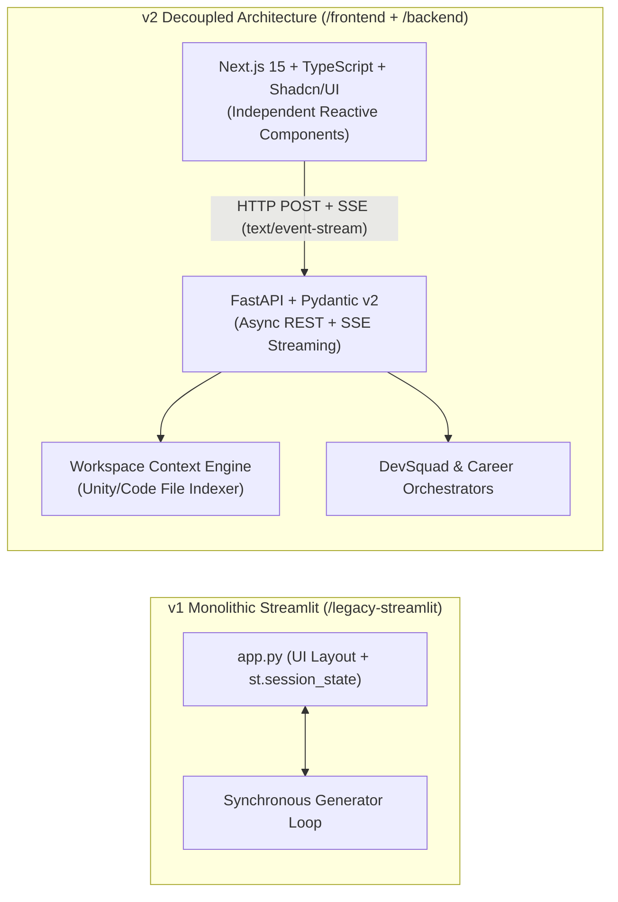

# ADR-001: Migration from Monolithic Streamlit to Decoupled Next.js + FastAPI Architecture

- **Status:** Accepted
- **Date:** 2026-11-11
- **Deciders:** Lead Software Architect, Frontend UX Engineering, Backend FastAPI Engineering
- **Supersedes:** Legacy Monolithic Prototype (`/legacy-streamlit/app.py`)

---

## 1. Context and Problem Statement

Hermes Studio v1 was initially developed as a monolithic Python Streamlit application (`legacy-streamlit/app.py`) to rapidly validate our core hypothesis: *can a 5-agent open-weights pipeline (`Hermes 3 70B` + `Qwen 2.5 Coder 32B`) match or exceed frontier IDE assistants on Unity C# and full-stack software tasks at <15% of the monthly cost?*

While Streamlit validated the multi-agent prompts and career intelligence workflows, it introduced severe architectural bottlenecks as the system evolved toward an interactive, Claude-Code-grade local IDE:

1. **Full-Script Re-Execution Model:** Every user interaction in Streamlit (toggling a tab, inspecting a file tree, or modifying a model dropdown) triggers a top-to-bottom Python script re-run. During a 45-second 5-agent pipeline run, any incidental UI interaction risked interrupting the generator loop or wiping transient state unless heavily shimmed with `st.session_state`.
2. **Lack of Granular Sub-Component Reactivity:** Real-time multi-agent orchestration requires independent, non-blocking UI viewports—such as inspecting Step 1 (Leader Architecture Spec) while Step 2 (Code Maker) streams code and the Workspace Drawer displays indexed Unity C# scripts. Streamlit's vertical block layout cannot support IDE-grade split panes, keyboard command palettes, or zero-flicker Server-Sent Events (SSE) telemetry.
3. **Tight Coupling of UI and Orchestration Logic:** Mixing `st.spinner()`, `st.expander()`, and `st.session_state` directly with OpenRouter API calls prevented headless automated testing, REST API reuse, and concurrent execution.

---

## 2. Decision Outcome

We decided to **archive the Streamlit prototype into `/legacy-streamlit`** and re-architect Hermes Studio v2 into a **strictly decoupled two-tier system**:

1. **Presentation Tier (`/frontend`):** **Next.js (App Router) + TypeScript + Tailwind CSS + Shadcn/UI** providing a dark-mode native, low-latency IDE interface with fine-grained React state management and native `ReadableStream` SSE consumption.
2. **Orchestration & Systems Tier (`/backend`):** **Python FastAPI + Pydantic v2** exposing stateless REST endpoints and asynchronous Server-Sent Events (`text/event-stream`) pipelines for multi-agent execution, local Unity/software directory indexing, and DuckDuckGo career intelligence scraping.

---

## 3. Considered Options

| Criterion | Option A: Retain & Patch Streamlit | Option B: Electron + Node.js Backend | Option C: Next.js (React/TS) + Python FastAPI (Selected) |
| :--- | :--- | :--- | :--- |
| **UI/UX Polish & IDE Ergonomics** | Low (constrained by widget model) | High | **High** (Tailwind + Shadcn/UI + Framer-grade transitions) |
| **Real-Time Streaming (SSE)** | Brittle (re-run lifecycle conflicts) | Native | **Native** (FastAPI `StreamingResponse` + Web Streams API) |
| **Python AI Ecosystem Reuse** | High | Low (requires rewriting Python agents in JS) | **100%** (Preserves `openai` SDK, `duckduckgo-search`, Python `pathlib`) |
| **Static Type Safety** | Partial (Python only) | High (TypeScript) | **End-to-End** (TypeScript strict mode + Pydantic v2 schemas) |
| **Portfolio & Production Signal** | Prototype-grade | Heavy binary footprint | **Production-grade Full-Stack AI Systems Engineering** |

---

## 4. Architectural Consequences

### Positive Consequences
- **Non-Blocking Multi-Agent Telemetry:** The Next.js frontend consumes `text/event-stream` payloads over an asynchronous `ReadableStream`, allowing engineers to browse previously completed agent outputs, copy code snippets, or inspect the indexed Unity file tree while downstream agents continue executing.
- **Strict API Contracts:** Pydantic v2 request/response models in FastAPI mirror TypeScript interfaces in Next.js, catching malformed payloads at compile/validation time.
- **Testability & Extensibility:** The FastAPI backend can be verified independently via `pytest` / `curl` / OpenAPI (`/docs`), and the `/legacy-streamlit` CLI/prototype remains preserved as a lightweight reference without polluting the production codebase.

### Negative Consequences & Mitigations
- **Dual-Process Local Runtime:** Running v2 locally requires starting both the Uvicorn server (`:8000`) and the Next.js dev/production server (`:3000`).
  - *Mitigation:* Documented one-command startup workflows and configured explicit CORS middleware in FastAPI for `http://localhost:3000`.
