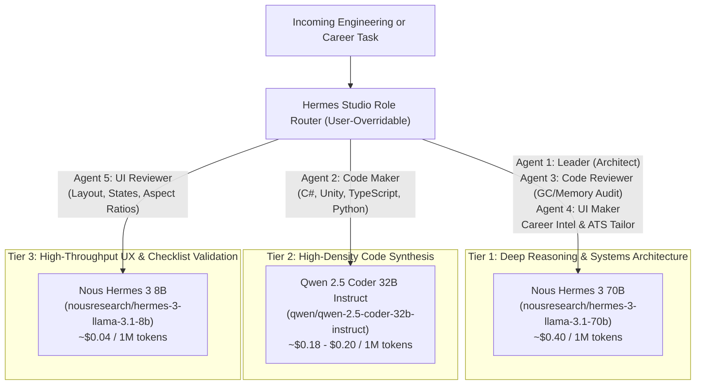

# ADR-003: Cost-Optimized Hybrid Multi-Agent Orchestration via OpenRouter

- **Status:** Accepted
- **Date:** 2026-11-11
- **Deciders:** Lead Software Architect, AI Systems Engineering
- **Related Components:** `/backend` DevSquad & Career Intelligence Orchestrators, `/legacy-streamlit/config.py`

---

## 1. Context and Problem Statement

Modern autonomous coding workflows require multiple iterative passes: architectural planning, code synthesis, static bug/memory review, UI layout binding, and UX validation. However, executing a 5-agent pipeline against commercial frontier subscriptions or single-model APIs presents three major operational problems:

1. **Subscription Rate-Limit Lockouts:** Flat-rate $20/month consumer subscriptions (e.g., Claude Pro, ChatGPT Plus) impose strict rolling 3-to-5-hour message quotas. Running 5 sequential multi-thousand-token agent prompts per task exhausts a user's quota after just 4–6 complex engineering tasks.
2. **Cognitive Mismatch of Monolithic Model Selection:** Using a massive frontier model for lightweight structural validation (like Step 5 UI Checklist Review) wastes 10x in token costs and adds unnecessary latency. Conversely, using a small 8B model for Step 1 System Architecture or Step 3 Unity Garbage Collection auditing yields shallow designs and missed memory leaks.
3. **Refusal Friction on Technical Scraping & Interview Analysis:** Over-aligned proprietary models frequently issue false-positive refusals or preachy boilerplate when asked to ruthlessly critique a candidate's C# interview answer or synthesize candid Reddit interview reports.

---

## 2. Decision Outcome

We implemented a **Heterogeneous Multi-Agent Routing Architecture** backed by the **OpenRouter Unified API**, assigning specialized open-weights models to each agent role based on cognitive demand, coding benchmark performance, and token economics:

### Default Role-to-Model Assignment Matrix

| Agent Role | Assigned Default Model | Rationale & Technical Strengths |
| :--- | :--- | :--- |
| **1. Leader (Architect)** | `nousresearch/hermes-3-llama-3.1-70b` | Excels at zero-fluff systems decomposition, SOLID interface contracts, and structured instruction following without conversational filler. |
| **2. Code Maker** | `qwen/qwen-2.5-coder-32b-instruct` | Purpose-trained on 5.5T code tokens; rivals frontier models on C#, Unity `MonoBehaviour`/`ScriptableObject` patterns, shaders, and TypeScript at half the cost of 70B weights. |
| **3. Code Reviewer** | `nousresearch/hermes-3-llama-3.1-70b` | Deep analytical reasoning required to spot subtle Unity frame-loop heap allocations (`GetComponent` in `Update()`, LINQ boxing, uncached coroutines) and concurrency bugs. |
| **4. UI Maker** | `nousresearch/hermes-3-llama-3.1-70b` | Strong cross-domain understanding of Unity UI Toolkit (`.uxml`/`.uss`), uGUI Canvas hierarchies, and modern React/Tailwind component composition. |
| **5. UI Reviewer** | `nousresearch/hermes-3-llama-3.1-8b` | Ultra-fast, low-latency validation of UX heuristics (16:9 vs 21:9 responsiveness, hover/disabled states, accessibility contrast) at 1/10th the cost of a 70B model. |
| **Career & Interview Suite** | `nousresearch/hermes-3-llama-3.1-70b` | Uncompromising, direct technical evaluation for Mock Interviews and high-precision keyword alignment for ATS Resume Tailoring. |

*(Note: Users can dynamically override any role in the IDE settings to use `Hermes 3 405B` or `Claude 3.5 Sonnet` for extreme edge cases.)*

---

## 3. Economic & Performance Benchmark Analysis

Assuming a typical **5-Agent Dev Squad run** with **12,000 input tokens** (task + workspace context + upstream agent outputs) and **4,500 output tokens** across all 5 steps:

| Architecture Strategy | Avg Cost per 5-Agent Run | Cost for 150 Runs / Month | Rate-Limit / Throttling Risk |
| :--- | :--- | :--- | :--- |
| **Consumer Subscription ($20/mo Flat)** | Fixed $20.00/mo | $20.00/mo | **High** (Locked out after ~5 consecutive multi-agent runs) |
| **All-Frontier API (e.g., Claude 3.5 Sonnet)** | ~$0.18 – $0.28 | ~$27.00 – $42.00/mo | Low |
| **Hermes Studio v2 Hybrid Routing (Selected)** | **~$0.022 – $0.031** | **~$3.30 – $4.65/mo** | **Zero** (Pay-as-you-go OpenRouter pool with provider fallback) |

---

## 4. Consequences

### Positive Consequences
- **85% Cost Reduction with Zero Throttling:** Engineers can execute 150+ full 5-agent pipelines and dozens of live job/interview scans per month for **~$3.50–$5.00 total**, completely eliminating subscription lockouts during crunch sprints.
- **Deterministic, Zero-Refusal Persona Adherence:** Nous Hermes 3's neutral instruction tuning adheres strictly to technical system prompts (e.g., acting as an uncompromising Principal Game Engineer during mock interviews).
- **Runtime Configurability:** Every role mapping is parameterized in both the API payload (`role_models`) and environment configuration, preventing vendor lock-in.

### Negative Consequences & Mitigations
- **External API Dependency:** Requires an active internet connection to reach OpenRouter's inference gateway.
  - *Mitigation:* Because the backend uses the standard OpenAI-compatible SDK format (`base_url="https://openrouter.ai/api/v1"`), engineers running high-VRAM workstations can point `OPENROUTER_BASE_URL` to a local `Ollama` or `vLLM` server with zero code changes.
